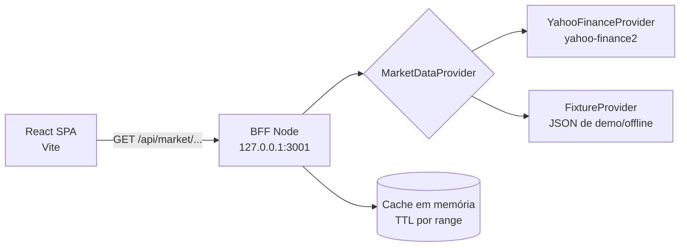

# Plano de implementação: painel de mercado IBM vs. concorrentes (React + Yahoo Finance)

## 1. O que encontrei no repositório

| Achado | Implicação |
|---|---|
| [`finance-app/`](finance-app) existe, mas está **vazio**. | É o ponto de partida. Todo o código da aplicação vai nesse diretório. |
| Não há `package.json` na raiz nem em `finance-app/`. | O CI atual não valida nada. |
| [`finance-app-ci.yml`](.github/workflows/finance-app-ci.yml) roda `npm install`, `lint`, `test` e `build` com `--if-present` **na raiz**, com `cache: npm`. | Falta `working-directory: finance-app`. Sem lockfile, o `setup-node` com `cache: npm` tende a falhar. Hoje o CI não protege nada. |
| O CI usa Node 20. A máquina de desenvolvimento tem Node 24.20.0. | Alinhe a versão com `.nvmrc` e `engines`. |
| Não há `.gitignore`. | Crie um antes do primeiro commit, por exigência da política de segurança. Ele deve cobrir `node_modules`, `.env*`, `dist` e `coverage`. |
| [`PULL_REQUEST_TEMPLATE.md`](.github/PULL_REQUEST_TEMPLATE.md) roda `npm install/test/build` na raiz. | Ajuste os comandos para `finance-app/`. |
| Os workshops ([parte 1](WORKSHOP-part1-BUILD.md), [parte 2](WORKSHOP-part2-GITHUB-AUTOMATION.md)) e [`docs/pr-feature-request-example.md`](docs/pr-feature-request-example.md) definem o escopo. | Os requisitos são: 5 empresas (IBM, Microsoft, Oracle, SAP, Salesforce), 3 janelas de tempo e a feature futura "gráfico para ticker escolhido pelo usuário". A arquitetura deve tornar essa feature uma mudança pequena. |

**Premissa técnica:** `yahoo-finance2` é uma biblioteca **Node**. Ela não é confiável no navegador, por causa de CORS e da necessidade de cookie/crumb. Por isso a recomendação é um **proxy fino (BFF)** em Node. O próprio workshop já sugere essa alternativa na seção "Practical implementation note".

Versões estáveis atuais, consultadas no npm em `npm view`:

| Pacote | Versão |
|---|---|
| react | 19.3.1 |
| vite | 8.3.4 |
| vitest | 5.0.4 |
| recharts | 3.10.1 |
| @tanstack/react-query | 5.104.2 |
| msw | 3.0.3 |
| yahoo-finance2 | 4.0.3 |

Antes de fixar as versões, confirme o `engines.node` de cada pacote. Gere o lockfile e rode `npm audit`, pois a política exige varredura de dependências e lockfile.

---

## 2. Arquitetura geral



**Decisões principais:**
- **Monorepo simples** com um único `package.json` em `finance-app/`. As pastas `src/` (cliente) e `server/` (BFF) compartilham tipos em `shared/`. Não use workspaces: para um lab de 30 a 45 minutos eles só atrapalham.
- **Interface `MarketDataProvider`** no servidor, com duas implementações: Yahoo e fixtures. Se o Yahoo mudar ou bloquear, o laboratório continua funcionando com `MARKET_PROVIDER=fixture`. A UI e as transformações não mudam.
- **Normalização no servidor.** O cliente recebe um contrato estável (`SeriesDTO`) e nunca vê o formato bruto do Yahoo.
- **Dev:** o Vite faz proxy de `/api` para o BFF. Não há CORS e não há URL hardcoded no cliente.

---

## 3. Estrutura de pastas

```text
finance-app/
├─ package.json            # scripts: dev, dev:client, dev:server, lint, typecheck, test, build
├─ package-lock.json
├─ .nvmrc                  # Node LTS (ex.: 22), igual ao CI
├─ tsconfig.json
├─ vite.config.ts          # proxy /api -> 127.0.0.1:3001, config do vitest
├─ eslint.config.js
├─ .env.example            # MARKET_PROVIDER=yahoo|fixture, PORT=3001 (sem segredos)
├─ index.html
├─ shared/
│  ├─ types.ts             # Range, Quote, SeriesPoint, SeriesDTO, ApiError
│  └─ companies.ts         # lista configurável: IBM + até 4 concorrentes (máx. 5)
├─ server/
│  ├─ index.ts             # bootstrap, bind em 127.0.0.1, timeouts
│  ├─ app.ts               # rotas e middlewares (testável sem abrir porta)
│  ├─ routes/market.ts     # GET /api/market/quotes, GET /api/market/history
│  ├─ providers/
│  │  ├─ MarketDataProvider.ts   # interface
│  │  ├─ yahooProvider.ts
│  │  └─ fixtureProvider.ts
│  ├─ domain/
│  │  ├─ ranges.ts         # mapa Range -> {period1, interval}
│  │  ├─ normalize.ts      # bruto -> SeriesDTO (descarta nulls, ordena, valida)
│  │  └─ validation.ts     # allowlist de símbolos e ranges
│  ├─ cache.ts             # TTL em memória
│  └─ errors.ts            # erros tipados -> respostas genéricas
├─ src/
│  ├─ main.tsx, App.tsx
│  ├─ api/
│  │  ├─ client.ts         # fetch com timeout/AbortSignal e parse de erro
│  │  └─ marketApi.ts      # getQuotes(), getHistory(symbols, range)
│  ├─ hooks/
│  │  ├─ useQuotes.ts      # TanStack Query
│  │  └─ useHistory.ts
│  ├─ domain/
│  │  ├─ metrics.ts        # variação %, rebase em 0%, ranking
│  │  └─ format.ts         # moeda, %, datas por range
│  ├─ components/
│  │  ├─ layout/ (AppShell, Header)
│  │  ├─ controls/ (RangeTabs)
│  │  ├─ summary/ (SummaryCardGrid, SummaryCard, RankingTable)
│  │  ├─ charts/ (ComparisonChart, CompanyChartCard, ChartTooltip)
│  │  └─ feedback/ (LoadingState, ErrorState, PartialDataBanner, ErrorBoundary)
│  ├─ pages/DashboardPage.tsx
│  └─ test/ (setup.ts, msw handlers, fixtures/)
├─ e2e/                    # opcional, fase posterior (Playwright)
└─ README.md               # como rodar, validar, estender
```

Ajustes fora de `finance-app/`:
- `.gitignore` na raiz.
- CI e PR template apontando para `finance-app/`.
- `.github/ISSUE_TEMPLATE/`, `CODEOWNERS` e `AGENTS.md` (veja a seção 12).

---

## 4. Janelas de tempo e mapeamento Yahoo

| Visão | Janela | Intervalo | Observação |
|---|---|---|---|
| **Dia atual** | Sessão corrente | 5 min | Fora do pregão ou em fim de semana, use o **último pregão disponível** e mostre um rótulo "Último pregão: dd/mm". |
| **7 dias** | Hoje − 7 dias corridos | 30 min ou 1 h | Cobre cerca de 5 pregões. Os dados têm lacunas de fim de semana, então use eixo categórico ou por timestamp com `connectNulls=false`. |
| **Trimestre** | Cerca de 3 meses | 1 dia | `period1 = now − 3 meses` (rolling). Se o produto quiser trimestre calendário, isso vira uma issue separada. |

Essa tabela fica centralizada em `server/domain/ranges.ts` e é a única fonte de verdade.

**Comparação entre empresas:** preços absolutos não são comparáveis (IBM e Salesforce têm preços e moedas diferentes). Os gráficos comparativos usam **variação % rebaseada em 0% no primeiro ponto da janela** (`metrics.ts`). Os cards mostram o preço absoluto e a variação do dia.

---

## 5. Delimitação de componentes React

```text
DashboardPage          ← orquestra: range selecionado + hooks
├─ Header + RangeTabs  ← controla apenas o range (1D | 7D | 3M)
├─ PartialDataBanner   ← "Sem dados para SAP" (falha parcial)
├─ SummaryCardGrid     ← 1 SummaryCard por empresa (preço, Δ dia, Δ janela)
├─ ComparisonChart     ← linhas rebaseadas, IBM em destaque
└─ RankingTable        ← ranking pela variação na janela
```

**Regras de fronteira:**
- Componentes em `components/` são **apresentacionais**. Recebem dados prontos por props e não conhecem `fetch` nem Yahoo.
- Só `DashboardPage` e os hooks falam com a camada `api/`.
- Cálculos (variação, rebase, ranking) ficam em `domain/metrics.ts`, como funções puras. É onde está a maior parte dos testes de valor.
- `CompanyChartCard` é um card de gráfico para **uma** empresa. Ele não é obrigatório no MVP, mas é a peça que a feature futura "gráfico para o ticker escolhido" vai reutilizar. Defini-lo agora evita refatoração depois.

---

## 6. Abstração dos serviços de dados

```ts
// server/providers/MarketDataProvider.ts
export interface MarketDataProvider {
  getQuotes(symbols: string[]): Promise<QuoteResult[]>;
  getHistory(symbol: string, range: Range): Promise<SeriesDTO>;
}
// QuoteResult = { symbol, ok: true, data } | { symbol, ok: false, error }
```

- **Falha por símbolo, não global.** Use `Promise.allSettled` no BFF. Um ticker ruim não derruba o painel.
- **Contrato da API:**
  - `GET /api/market/quotes?symbols=IBM,MSFT,...`
  - `GET /api/market/history?symbols=IBM,MSFT,...&range=1d|7d|3m`
- **Normalização (`normalize.ts`):** remove pontos com `close == null`, ordena por timestamp, converte para número, garante a moeda e devolve série vazia explícita quando não há dados.
- **Cache:** TTL em memória (por exemplo 30 s para 1D, 5 min para 7D, 1 h para 3M). Isso reduz chamadas e o risco de rate limit.
- **Lista de empresas:** `shared/companies.ts` (IBM + até 4, com validação de que o máximo é 5). Adicionar uma empresa é editar uma linha.
- **Frontend:** `marketApi.ts` expõe funções tipadas. Os hooks encapsulam o TanStack Query. Trocar a fonte de dados não toca a UI.

---

## 7. Gráficos

**Recomendação: Recharts.**
- É declarativo e idiomático em React (`LineChart`, `Line`, `ResponsiveContainer`, `Tooltip`) e fácil para Bob gerar e manter.
- Suporta bem o caso de uso: linhas múltiplas para a comparação e área para a tendência do trimestre.
- Alternativa se o volume de pontos crescer muito: uPlot ou ECharts. A fronteira `ComparisonChart` e `CompanyChartCard` isola essa troca.

**Diretrizes:**
- Dados chegam ao gráfico já rebaseados. O componente só renderiza.
- Séries por empresa com cores fixas e acessíveis. IBM tem traço mais grosso.
- Eixo X formatado por range (HH:mm no 1D, dd/MM no 7D e 3M).
- O tooltip mostra o valor em % e o preço absoluto.
- Estados vazios e carregando são tratados **fora** do gráfico.

---

## 8. Gerenciamento de estado

| Tipo de estado | Onde vive | Motivo |
|---|---|---|
| Dados remotos (quotes, séries) | **TanStack Query** | Cache, deduplicação, retry, `isLoading`/`isError`, `staleTime` por range e refetch controlado. |
| Range selecionado | `useState` em `DashboardPage`, **espelhado em `?range=` na URL** | Permite compartilhar o link e é ótimo para demo. |
| UI efêmera | `useState` local | Não precisa de store global. |

Não use Redux nem Zustand no MVP. Se a feature de "ticker escolhido" crescer, o estado do ticker segue o mesmo padrão: parâmetro de URL mais query key `['history', symbol, range]`.

---

## 9. Tratamento de erros

**Servidor (seguindo as regras de segurança):**
- Erros tipados em `errors.ts`: `InvalidSymbol` (400), `InvalidRange` (400), `UpstreamUnavailable` (502), `Timeout` (504).
- Corpo genérico para o cliente (`{"error":{"code":"UPSTREAM_UNAVAILABLE","message":"Dados indisponíveis"}}`), **sem stack trace** nem detalhes do Yahoo. O detalhe vai só para o log estruturado (JSON).
- **Validação por allowlist** de símbolos (`^[A-Z.\-]{1,10}$`, mais a lista configurada) e de ranges. Máximo de 5 símbolos por requisição.
- **Timeouts** na chamada upstream e na requisição. Nada de espera infinita.
- Bind em **127.0.0.1**, nunca `0.0.0.0`. Não há segredos. Se algum dia houver, use variáveis de ambiente e `.env` ignorado pelo git.
- HTTPS para chamadas externas (o Yahoo já usa).

**Cliente:**
- `ErrorBoundary` na raiz para falhas inesperadas de renderização.
- `ErrorState` com botão "Tentar novamente" (`refetch`) para falha total.
- `PartialDataBanner` e cards "indisponível" para falha de um símbolo, sem esconder os demais.
- Estados explícitos: carregando (skeleton), vazio ("sem dados para o período") e erro.
- Mensagens ao usuário em linguagem simples. Nada de `error.message` cru.

---

## 10. Estratégia de testes

| Camada | Ferramenta | O que cobrir |
|---|---|---|
| **Unitário (domínio)** | Vitest | `metrics.ts` (rebase, variação, ranking, divisão por zero, série vazia), `normalize.ts` (nulls, ordem), `ranges.ts` e `validation.ts` (símbolos e ranges inválidos). **Prioridade máxima.** |
| **Servidor** | Vitest + `supertest` (ou `app.request`) | Rotas com `FixtureProvider` injetado: 200, 400 em símbolo inválido, falha parcial e erro upstream sem vazar detalhes. |
| **Contrato do provider** | Vitest | `yahooProvider` com resposta bruta gravada (snapshot de JSON real), garantindo que o mapeamento para `SeriesDTO` não quebra. **Sem rede nos testes.** |
| **Componentes** | Vitest + React Testing Library + MSW | `DashboardPage`: renderiza os 5 cards, troca de range dispara nova busca, estado de loading, estado de erro e banner de falha parcial. |
| **E2E (opcional, fase 2)** | Playwright | Fluxo feliz com o BFF em modo fixture. |

**Regras:** os testes nunca chamam o Yahoo real. O CI deve ser determinístico. Um teste opcional "smoke live" fica manual (`npm run smoke:live`), fora do CI.

---

## 11. Validação local (definição de "pronto")

```bash
cd finance-app
nvm use                  # Node do .nvmrc
npm ci                   # instalação reproduzível pelo lockfile
npm audit                # sem vulnerabilidades High/Critical
npm run lint             # 0 erros e 0 warnings
npm run typecheck        # tsc --noEmit
npm test                 # todos verdes (inclui servidor e UI)
npm run build            # build do client sem erros
MARKET_PROVIDER=fixture npm run dev    # fluxo offline (demo seguro)
npm run dev                            # com Yahoo real (checagem manual)
```

**Checklist manual:**
1. Abrem 5 cards (IBM e 4 concorrentes), com preço e variação.
2. Alternar 1D, 7D e 3M muda o gráfico e a URL (`?range=`).
3. Desligar a rede ou usar um símbolo inválido mostra erro parcial, sem tela branca.
4. `curl "http://127.0.0.1:3001/api/market/history?symbols=IBM&range=7d"` devolve JSON normalizado.
5. `lsof -i :3001` mostra o bind só em `127.0.0.1`.

---

## 12. Evolução via GitHub (issues e pull requests)

**Como o código facilita isso:** cada feature futura cai em um ponto de extensão já previsto, então os PRs ficam pequenos.

| Feature futura | Ponto de extensão |
|---|---|
| Gráfico para ticker escolhido pelo usuário (exemplo em [`docs/`](docs/pr-feature-request-example.md)) | Novo `TickerSearch` mais o `CompanyChartCard` já existente, o hook `useHistory([symbol], range)` e a validação em `validation.ts`. |
| Nova empresa | Linha em `shared/companies.ts`. |
| Novo range (ex.: 1 ano) | Entrada em `ranges.ts` mais uma aba em `RangeTabs`. |
| Troca de fonte de dados | Novo `MarketDataProvider`. |
| Novo tipo de gráfico | Novo componente em `charts/`, sem tocar a camada de dados. |

**Processo:**
1. **Issue primeiro.** Crie `.github/ISSUE_TEMPLATE/feature.yml` com: contexto de negócio, comportamento esperado, **critérios de aceitação** (lista verificável) e áreas de código prováveis. O exemplo da pasta `docs/` já tem esse formato.
2. **Labels:** `feature`, `bug`, `data-integration`, `chart`, `tests`, `good-first-bob`, `bob-assisted`.
3. **Branches:** `feature/<slug>`, `fix/<slug>` e `bob/<issue-nº>-<slug>`, que já são disparadas pelo CI.
4. **PRs pequenos**, um por issue, com `Closes #N`. Use [`PULL_REQUEST_TEMPLATE.md`](.github/PULL_REQUEST_TEMPLATE.md) preenchido a partir do diff, com os comandos reais de validação.
5. **CI como portão** (corrigir antes de qualquer feature): `working-directory: finance-app`, `npm ci`, `lint`, `typecheck`, `test`, `build`, `npm audit --audit-level=high`, Node alinhado ao `.nvmrc`, e remover `--if-present` para que a ausência de scripts falhe em vez de passar em silêncio. Proteção da `main` com checks obrigatórios e revisão.
6. **`CODEOWNERS`** e **`AGENTS.md`** em `finance-app/` (ou regras em `.bob/`), documentando convenções: onde fica cada responsabilidade, "testes nunca chamam rede", "bind só em 127.0.0.1" e "novas dependências exigem checagem de manutenção e audit". Isso faz o Bob (ou qualquer contribuidor) acertar a camada na primeira tentativa.
7. **Commits** em Conventional Commits (`feat:`, `fix:`, `test:`, `ci:`), que facilitam changelog e revisão.
8. **Limite de atuação do Bob:** ele implementa, valida e faz push na branch. O merge continua sendo uma ação do mantenedor, como o README já descreve.

---

## 13. Sequência sugerida de entrega (PRs)

| PR | Conteúdo | Pronto quando |
|---|---|---|
| **0. Fundação** | `.gitignore`, correção do CI e do PR template, `.nvmrc`, `AGENTS.md`, templates de issue. | CI verde (mesmo com projeto mínimo). |
| **1. Scaffold** | Vite + React + TS, lint, vitest e `App` mínimo. | `npm run lint`, `test` e `build` passam. |
| **2. Dados** | `shared/`, BFF, providers (fixture primeiro, depois Yahoo), `normalize`, `ranges`, cache, testes. | Rotas respondem e os testes passam sem rede. |
| **3. Domínio de UI** | `metrics.ts`, `format.ts`, `api/` e hooks, com testes. | Cobertura alta das funções puras. |
| **4. Dashboard** | Cards, `RangeTabs`, `ComparisonChart`, ranking e estados de erro e loading. | Checklist manual da seção 11 completo. |
| **5. Docs e demo** | README do app e screenshots. | Um terceiro roda tudo seguindo o README. |
| **Parte 2 do lab** | Issue "ticker escolhido pelo usuário" implementada pelo Bob. | Critérios de aceitação cumpridos, sem remover os dashboards existentes. |

---

## 14. Riscos e mitigação

| Risco | Mitigação |
|---|---|
| O Yahoo muda ou bloqueia o acesso (API não oficial). | `FixtureProvider` como fallback e modo demo offline, mais cache e timeouts. |
| Dados de 1D e 7D vazios fora do pregão. | Regra do "último pregão disponível" com rótulo explícito. |
| Rate limit. | Cache com TTL, uma requisição por range para vários símbolos e `staleTime` no cliente. |
| Dependências desatualizadas ou com CVE. | `npm ci`, `npm audit` no CI e revisão de atualizações antes do merge. |
| O CI "verde" sem testar nada. | Remover `--if-present` e definir `working-directory`. |

---

## 15. Próximo passo

Começar pelo **PR 0 (fundação)**: criar o `.gitignore`, corrigir o CI e o PR template e criar os templates de issue. Depois seguir para o scaffold do PR 1.
